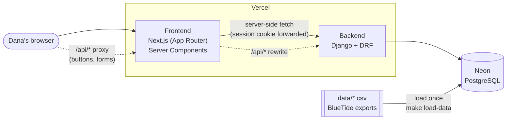

# Kestrel Bay: Inventory for Dana

**Live app:** https://kestrel-bay-rosy.vercel.app
**Demo login:** `dana` / `kestrel-monday`

A small web app that gives Dana, the VP of Purchasing at Kestrel Bay Seafood, **one screen for
Monday morning** that answers two questions:

1. **What will run out before a new order could arrive?** (Order now / Tight)
2. **What stock are we stuck with?** (expiring lots, too much stock, dead items, Harbor first)

Click any number to see why it is what it is. You can also tell the app what it can't know: real
lead times, and "I've already ordered this."

## The brief

> **Background**
> Kestrel Bay Seafood is a fictional seafood distributor. We had a kickoff call with them last week,
> and their VP of Purchasing, Dana, needs help with her Monday ordering. All the materials are in
> this zip file.
>
> - `kickoff-call-transcript.md`: the primary source of requirements
> - `data/`: the exports they sent afterwards, exactly as they came out of their system
>
> **The Task**
> Build Dana an inventory app. It should be a small, working web application with a backend,
> database, and frontend, deployed to a live link (free hosting like Vercel is fine). You don't need
> to build an ETL pipeline. Loading the CSVs into the database once is fine.

How each part is met:

| Requirement | Where |
|---|---|
| Backend | Django REST API in `backend/` |
| Database | PostgreSQL (Neon in production), loaded once from `data/` |
| Frontend | Next.js app in `frontend/` |
| Deployed to a live link | https://kestrel-bay-rosy.vercel.app (Vercel) |
| No ETL pipeline | One command loads the CSVs once: `make load-data` |
| Raw exports untouched | `data/` is never edited; all cleaning happens in code |

"Today" is **Monday Nov 16, 2026**, as the brief says. It is set in config, never read from the
computer's clock.

## Architecture



**How a request flows**

1. Dana opens the site. The Next.js page fetches the dashboard from the Django API on the server,
   passing her login cookie along, and sends back finished HTML.
2. Django builds the dashboard from the database: it reads stock, sales, purchase orders and vendors,
   runs the business rules, and returns JSON.
3. Buttons and forms ("I've handled this", editing lead times) call `/api/*` from the browser. Next.js
   rewrites that to the Django API, so the login cookie stays on one domain.

**Backend layers** (`backend/inventory/`)

| Layer | Job |
|---|---|
| `loader.py` | One-time CSV load. Cleans the data traps (see Assumptions) and records what it did. |
| `rules/` | The business rules as small pure functions with no database access: demand, forecast, stockouts, run-out verdict, stuck stock, unit conversion. Each data trap has its own test. |
| `services.py` | Glue: reads the database, calls the rules, builds the dashboard and item-page payloads. |
| `views.py`, `serializers.py`, `urls.py` | The REST API: login, dashboard, item detail, "handled" flags, vendor lead times. |
| `models.py` | Vendor, Item, InventoryLot, PurchaseOrderLine, SalesLine, HandledFlag, DataNote. |

**Frontend** (`frontend/src/`)

- `app/`: pages (Monday screen, item page, vendors, login).
- `components/`: scrolling tile rows (`RiskTile`, `StuckTile`, `MiniTile`), the stock-projection chart,
  and the `Why` popover that explains every number.
- `lib/`: number formatting (`format.ts`), the "why" text built from API fields (`why.ts`), and the
  server and browser API helpers.
- The design is described in `frontend/DESIGN.md` ("Quiet ledger").

## Run it locally

You need Python 3.12 with [uv](https://docs.astral.sh/uv/), Node, and Docker (for Postgres).

```bash
make install       # backend + frontend dependencies
make db-up         # local Postgres (docker)
make migrate
make load-data     # one-time CSV load
make dev           # Django on :8000
make dev-frontend  # Next.js on :3000
```

Other commands:

```bash
make test          # backend tests
make lint          # ruff
make typecheck     # mypy
make check-all     # lint + typecheck + test + secret scan
```

Frontend, from `frontend/`: `npm test`, `npm run lint`, `npx tsc --noEmit`, `npm run build`.
API docs when running locally: http://localhost:8000/api/schema/swagger/

## Deployment

Two Vercel projects from this repo, plus a Neon Postgres database.

- **Frontend** (`frontend/`): deploys automatically on every push to `main`. `BACKEND_URL` points it
  at the API.
- **Backend** (`backend/`): deployed with `vercel deploy --prod` from `backend/`. Environment:
  `DJANGO_SETTINGS_MODULE=config.settings.prod`, `SECRET_KEY`, `DATABASE_URL` (Neon),
  `ALLOWED_HOSTS`, `CSRF_TRUSTED_ORIGINS` (the frontend URL), `AS_OF_DATE`; optionally
  `DANA_USERNAME` / `DANA_PASSWORD` to change the demo login.
- **Database:** `DATABASE_URL=<neon unpooled url> make migrate load-data` (one-time load).

## How the numbers work

In plain terms:

- **Stock** is what is sellable right now: New Bedford, Providence and Harbor. Hold and damaged
  stock don't count.
- **Demand** is a forecast of what will ship each day: the same month last year (so Lent and the
  holidays are covered), plus orders already booked.
- **Run-out date** is the first day projected stock goes below zero, counting purchase orders that
  are still on their way.
- **Order-by date** is the run-out date minus the vendor's real lead time.
- **Order now** means the order-by date is within 7 days (or already past). **Tight** means within 28.
- **Stuck** means lots with less than 6 months of shelf life, far too much stock, or dead items.

The full reasoning is in `docs/superpowers/specs/2026-11-19-dana-inventory-design.md`.

## Assumptions

Where the exports and the kickoff call left something open, this is what I decided.

### Scope
- Fresh / day-boat items (`FR-*`) are out: Dana said she doesn't need help there. Marco's asks
  (availability, pricing, routes, emails) are out too.
- `ZZ-*` items are dead whatever their status says. Statuses `A`, `active`, blank mean active;
  `DISC`, `Discontinued` mean discontinued.
- An active item with no real sales for 120 days is **dormant** (PAN-1012, SHR-6170, TIL-FIL). It
  gets no run-out verdict, and any stock shows under Stuck.

### Stock
- Only the **latest nightly snapshot** (Nov 15) counts. The file holds two nights.
- Sellable = New Bedford, Providence, Harbor. **QA-HOLD** is shown but not counted (it may come
  back). **DAMAGED** is ignored. Location doesn't matter for ordering, only for Harbor's storage cost.
- Duplicate item codes that differ only in case or spaces (`shr-1620 `, `Sal-Por6`, `COD-LOIN `) are
  merged into the clean code, and their stock and sales are added to it.
- Lots received in pounds for case items (CAL-RING, LOB-T56) are converted using the case weight
  parsed from the free-text pack size (`6x2.2lb`, `10 lb cs`, `10/2#`, `5kg`, ...).
- Negative `ADJ-*` rows are inventory adjustments and net against on-hand. Zero-quantity lots are dropped.

### Demand
- Real demand = invoiced lines with a positive quantity and price. Left out: cancelled lines,
  credits (negative sales), $0 samples, `TRANSFER - PVD`, and the one-off cruise-line order. The
  counts are shown on the dashboard under "How the numbers were cleaned".
- Demand is dated by ship date.
- **Booked-but-unshipped orders** are already promised. Each month's expected shipping is the larger
  of the forecast and what's booked, never both added together.
- **Stockouts:** when an item that normally sells every week goes 10+ days with no sales between two
  sales, it is treated as out of stock, and that month's demand is scaled up to the in-stock days.
  This stops last December's shrimp stockout from understating this December.
- **Forecast** = the same calendar month last year (stockout-corrected). A pace factor (last 8 weeks
  vs the same 8 weeks last year, limited to 0.7–1.3) exists but stays at 1.0 here, because the
  history starts 2025-10-29 and doesn't cover the prior-year window.

### Orders on the way
- Only `Open` PO lines count. Exact duplicate lines are counted once. Outstanding =
  ordered − received, so a part-received PO still counts its remainder.
- A PO still open past its expected date is **late**. That date is the vendor's original quote and
  nobody updates it, so **no arrival is assumed**. The PO is listed as late ("arrival unknown", with
  what the vendor said) and is not counted as stock on the way. An item whose shortfall only a late
  PO could close is flagged "Only a late order covers this".
- "I've handled this" with a quantity and date counts as stock on the way. Without them it parks the
  item for 14 days.

### Lead times and buffers (editable in the app)

| Vendor | Lead time | Buffer |
|---|---|---|
| Bien Xanh (Vietnam) | 84 days (10–12 weeks; BlueTide's 56 is stale) | 14 days |
| Austral Frío (Chile) | 42 days (blank in BlueTide) | 14 days |
| Maritime Northern Pack (Canada) | 14 days | 7 days |
| Aleutian Shore (Alaska) | 28 days | 7 days |
| Downeast Lobster (Maine) | 21 days ("2-3 wks" in BlueTide) | 7 days |

### Verdicts
- Run-out = first day projected stock goes below zero. Order-by = run-out − lead time.
- Suggested quantity covers the buffer plus 28 days after the order would arrive, rounded up to
  whole cases.

### Stuck stock
- Lots with under **6 months** of shelf life left (nobody will take them), including already-expired
  lots; item-level "too much stock" above 180 days of cover (only the part not already flagged);
  and dead or dormant items. Valued at cost. Harbor stock is listed first.

## Out of scope

Left out on purpose, so Dana's Monday screen could be right first:

- **Fresh / day-boat buying.** Dana said it's a separate daily job.
- **Marco's asks:** availability lookup, pricing (the price list is not loaded), route planning and
  email drafting. Walt's call was "Dana first".
- **Live BlueTide connection, re-uploads or an ETL pipeline.** The CSVs are loaded once.
- **Creating or sending purchase orders.** Suggested quantities are suggestions only.
- **Multiple users or roles.** There is one shared login for Dana.
- **Background jobs** (no Celery, Redis or error-tracking service).

## What I'd do next

- **Show a "last updated" time** on the dashboard, so Dana knows which nightly snapshot she is seeing.
- **Add stuck-stock details:** days on hand, last sale date and a suggested action (discount, move or dump).
- **Show stock movements** on the item page, so a change in on-hand can be explained.
- **Turn on the pace factor** once there is more than one year of history.
- **Throttle login attempts.** The live login has no rate limit.
- **Cache the dashboard.** It recomputes about 15,000 sales rows on every request. That is fast at
  this size but won't scale.
- **Check phones and other browsers.** The UI has only been tested in Chrome.
- **Let Dana confirm the assumptions** that came from me rather than from her: the 120-day dormant
  rule, the 180-day "too much stock" line and the buffer days.
- **Git-link the backend** Vercel project so it deploys on push like the frontend.

## How I used AI tools

I used **Claude Code** only, with no other AI tools. We worked as a pair: I made the decisions and
Claude did much of the typing.

- **Planning:** Claude helped turn the kickoff transcript into a design spec and a task plan (both
  are in `docs/superpowers/`). I chose the hosting, the single shared login and the lead times and
  buffer days.
- **Building:** the business rules were written test-first, with one test per data trap in the CSVs.
  Claude wrote most of the backend and frontend code, and I reviewed it.
- **Checking:** the rules, API and screens were run against the real exports, and the figures were
  compared with the raw CSVs. Lint, type checks, tests and a production build run in CI.
- **Assumptions:** where the transcript and the data left something open, the choice is written down
  in the Assumptions section above rather than buried in code.

## Original brief

> # Kestrel Bay Seafood: take-home
>
> **Treat Monday, November 16, 2026 as today.** The kickoff call was the week before (Nov 10), and the data runs to the Nov 15 snapshot. Use Nov 16 for anything date-based (expiry, run-out, lead times), not your computer's clock.
>
> 1. Read `kickoff-call-transcript.md`. That's the customer, and the requirements.
> 2. `data/` holds the exports Kestrel Bay sent after the call, exactly as they came out of their system.
> 3. The task, timing and what to submit are in the email we sent. Questions: email me and I'll answer as Dana would, or make a reasonable assumption and write it down.
